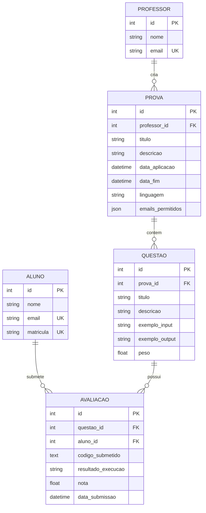

# Escola API - Test Maker System

Sistema de criação e avaliação de provas de programação desenvolvido com FastAPI.

## Descrição

Este projeto é uma API REST para gerenciar provas de programação onde:
- **Professores** criam provas (templates) com casos de teste
- **Alunos** submetem código como resposta às provas
- **Avaliações** armazenam as submissões dos alunos e resultados da execução

## Tecnologias

- **FastAPI** - Framework web
- **SQLAlchemy** - ORM para banco de dados
- **SQLite** - Banco de dados
- **Pydantic** - Validação de dados
- **Pytest** - Testes automatizados

## Pré-requisitos

- Python 3.12+
- pip (gerenciador de pacotes Python)
- Virtual environment (recomendado)

## Instalação e Configuração

### 1. Ativar o Ambiente Virtual

```bash
# Navegue até o diretório do projeto
cd /home/vitor/git/tcc/back/escola_api

# Ative o ambiente virtual (localizado em ../env)
source ../env/bin/activate
```

### 2. Instalar Dependências

```bash
# Instalar dependências necessárias (caso ainda não estejam instaladas)
pip install fastapi uvicorn sqlalchemy pydantic 'pydantic[email]' pytest httpx
```

### 3. Configurar o Banco de Dados

O banco de dados SQLite será criado automaticamente na primeira execução.
Se você quiser recriá-lo do zero:

```bash
# Remover o banco de dados existente (CUIDADO: isso apaga todos os dados!)
rm -f school.db

# O banco será recriado automaticamente ao iniciar a aplicação
```

## Como Executar a Aplicação

### Iniciar o Servidor

```bash
# Certifique-se de que o ambiente virtual está ativo
source ../env/bin/activate

# Inicie o servidor com reload automático (modo desenvolvimento)
uvicorn app.main:app --reload
```

O servidor estará disponível em: **http://localhost:8000**

### Acessar a Documentação Interativa

Após iniciar o servidor, acesse:

- **Swagger UI**: http://localhost:8000/docs
- **ReDoc**: http://localhost:8000/redoc

## Como Executar os Testes

### Executar Todos os Testes

```bash
# Certifique-se de que o ambiente virtual está ativo
source ../env/bin/activate

# Execute todos os testes
python -m pytest tests/ -v
```

### Executar Testes Específicos

```bash
# Testar apenas Professor
python -m pytest tests/test_professor.py -v

# Testar apenas Aluno
python -m pytest tests/test_aluno.py -v

# Testar apenas Prova
python -m pytest tests/test_prova.py -v

# Testar apenas Avaliacao
python -m pytest tests/test_avaliacao.py -v
```

### Executar Testes com Cobertura

```bash
# Instalar coverage (se ainda não instalado)
pip install pytest-cov

# Executar testes com relatório de cobertura
python -m pytest tests/ --cov=app --cov-report=html

# Visualizar relatório (abre no navegador)
xdg-open htmlcov/index.html
```

## Estrutura da API

### Entidades

#### 1. **Professor** (Professores)
```json
{
  "id": 1,
  "nome": "Professor João",
  "email": "joao@escola.com"
}
```

**Endpoints:**
- `POST /professores/` - Criar professor
- `GET /professores/` - Listar todos os professores
- `GET /professores/{id}` - Buscar professor por ID
- `PUT /professores/{id}` - Atualizar professor
- `DELETE /professores/{id}` - Deletar professor

---

#### 2. **Aluno** (Alunos)
```json
{
  "id": 1,
  "nome": "Maria Silva",
  "email": "maria@aluno.com",
  "matricula": "2024001"
}
```

**Endpoints:**
- `POST /alunos/` - Criar aluno
- `GET /alunos/` - Listar todos os alunos
- `GET /alunos/{id}` - Buscar aluno por ID
- `PUT /alunos/{id}` - Atualizar aluno
- `DELETE /alunos/{id}` - Deletar aluno

---

#### 3. **Prova** (Provas/Testes)
```json
{
  "id": 1,
  "titulo": "Prova de Python Básico",
  "descricao": "Teste de funções matemáticas",
  "data_aplicacao": "2024-03-01",
  "professor_id": 1,
  "linguagem": "Python",
  "exemplo_input1": "5",
  "exemplo_output1": "25",
  "exemplo_input2": "10",
  "exemplo_output2": "100"
}
```

**Linguagens Suportadas:** Python, Java, C++, JavaScript

**Endpoints:**
- `POST /provas/` - Criar prova
- `GET /provas/` - Listar todas as provas
- `GET /provas/{id}` - Buscar prova por ID
- `GET /provas/professor/{professor_id}` - Listar provas de um professor
- `PUT /provas/{id}` - Atualizar prova
- `DELETE /provas/{id}` - Deletar prova

---

#### 4. **Avaliacao** (Submissões dos Alunos)
```json
{
  "id": 1,
  "prova_id": 1,
  "aluno_id": 1,
  "codigo_submetido": "def square(x):\n return x * x",
  "resultado_execucao": "Código executado com sucesso",
  "data_submissao": "2024-02-05T10:30:00",
  "nota": 10.0
}
```

**Endpoints:**
- `POST /avaliacoes/` - Criar avaliação (submeter código)
- `GET /avaliacoes/` - Listar todas as avaliações
- `GET /avaliacoes/{id}` - Buscar avaliação por ID
- `GET /avaliacoes/prova/{prova_id}` - Listar avaliações de uma prova
- `GET /avaliacoes/aluno/{aluno_id}` - Listar avaliações de um aluno
- `PUT /avaliacoes/{id}` - Atualizar avaliação (resubmeter código)
- `DELETE /avaliacoes/{id}` - Deletar avaliação
- `POST /avaliacoes/{id}/executar` - Executar código da avaliação

## Relacionamentos



### Cascade Deletes:
- Deletar Professor → Deleta suas Provas → Deleta Avaliações dessas Provas
- Deletar Aluno → Deleta suas Avaliações
- Deletar Prova → Deleta suas Avaliações

## Exemplo de Uso Completo

### 1. Criar um Professor
```bash
curl -X POST "http://localhost:8000/professores/" \
  -H "Content-Type: application/json" \
  -d '{
    "nome": "Professor João",
    "email": "joao@escola.com"
  }'
```

### 2. Criar um Aluno
```bash
curl -X POST "http://localhost:8000/alunos/" \
  -H "Content-Type: application/json" \
  -d '{
    "nome": "Maria Silva",
    "email": "maria@aluno.com",
    "matricula": "2024001"
  }'
```

### 3. Criar uma Prova
```bash
curl -X POST "http://localhost:8000/provas/" \
  -H "Content-Type: application/json" \
  -d '{
    "titulo": "Prova de Python",
    "descricao": "Função para calcular quadrado",
    "data_aplicacao": "2024-03-01",
    "professor_id": 1,
    "linguagem": "Python",
    "exemplo_input1": "5",
    "exemplo_output1": "25"
  }'
```

### 4. Submeter Código (Criar Avaliação)
```bash
curl -X POST "http://localhost:8000/avaliacoes/" \
  -H "Content-Type: application/json" \
  -d '{
    "prova_id": 1,
    "aluno_id": 1,
    "codigo_submetido": "def square(x):\n return x * x"
  }'
```

### 5. Executar Código
```bash
curl -X POST "http://localhost:8000/avaliacoes/1/executar"
```

## Estrutura de Diretórios

```
escola_api/
├── app/
│ ├── core/
│ │ ├── database.py # Configuração do banco de dados
│ │ ├── enums.py # Enums (LinguagemEnum)
│ │ └── configs.py # Configurações gerais
│ ├── models/
│ │ ├── professor_model.py # Modelo Professor
│ │ ├── aluno_model.py # Modelo Aluno
│ │ ├── prova_model.py # Modelo Prova
│ │ └── avaliacao_model.py # Modelo Avaliacao
│ ├── schemas/
│ │ ├── professor_schema.py # Schemas Pydantic Professor
│ │ ├── aluno_schema.py # Schemas Pydantic Aluno
│ │ ├── prova_schema.py # Schemas Pydantic Prova
│ │ └── avaliacao_schema.py # Schemas Pydantic Avaliacao
│ ├── repositories/
│ │ ├── professor_repository.py # Repository Professor
│ │ ├── aluno_repository.py # Repository Aluno
│ │ ├── prova_repository.py # Repository Prova
│ │ └── avaliacao_repository.py # Repository Avaliacao
│ ├── controllers/
│ │ ├── professor_controller.py # Endpoints Professor
│ │ ├── aluno_controller.py # Endpoints Aluno
│ │ ├── prova_controller.py # Endpoints Prova
│ │ └── avaliacao_controller.py # Endpoints Avaliacao
│ └── main.py # Aplicação FastAPI principal
├── tests/
│ ├── test_professor.py # Testes Professor
│ ├── test_aluno.py # Testes Aluno
│ ├── test_prova.py # Testes Prova
│ └── test_avaliacao.py # Testes Avaliacao
├── school.db # Banco de dados SQLite (gerado)
├── requirements.txt # Dependências Python
└── README.md # Este arquivo
```

## Arquitetura

O projeto segue uma arquitetura em camadas:

1. **Controller** (API/Rotas) → Recebe requisições HTTP
2. **Repository** (Acesso a Dados) → Operações CRUD no banco
3. **Model** (ORM) → Mapeamento objeto-relacional
4. **Schema** (Validação) → Validação e serialização de dados

## Variáveis de Ambiente

Atualmente, o projeto usa configurações padrão. Para produção, crie um arquivo `.env`:

```env
DATABASE_URL=sqlite:///./school.db
DEBUG=False
```

## Troubleshooting

### Erro: "ModuleNotFoundError: No module named 'httpx'"
```bash
pip install httpx
```

### Erro: "email-validator is not installed"
```bash
pip install 'pydantic[email]'
```

### Erro: Database locked
```bash
# Certifique-se de que não há múltiplas instâncias rodando
pkill -f uvicorn
rm school.db
```

### Testes falhando
```bash
# Recrie o banco de dados de teste
rm school.db
python -m pytest tests/ -v
```

## Resultado dos Testes

Última execução: **28 testes passaram** 

```
tests/test_professor.py ...... [ 21%] (6 testes)
tests/test_aluno.py ...... [ 43%] (6 testes)
tests/test_prova.py ....... [ 68%] (7 testes)
tests/test_avaliacao.py ......... [100%] (9 testes)
```

## TODO / Próximos Passos

- [ ] Integrar endpoint `/avaliacoes/{id}/executar` com o serviço executor em `/home/vitor/git/tcc/back/executor_code/`
- [ ] Adicionar autenticação JWT
- [ ] Implementar sistema de permissões (professores só editam suas provas)
- [ ] Adicionar filtros avançados nas listagens
- [ ] Implementar paginação
- [ ] Migrar para PostgreSQL (produção)
- [ ] Adicionar Docker e docker-compose
- [ ] Documentação de deploy

## Licença

Este projeto é parte de um TCC (Trabalho de Conclusão de Curso).

## Autores

Desenvolvido por Vitor

---

**Data da última atualização:** 05 de Fevereiro de 2026
